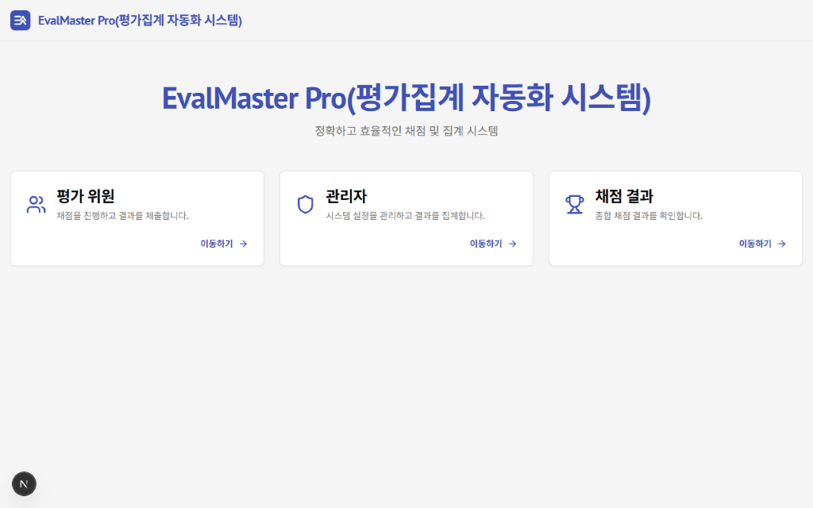
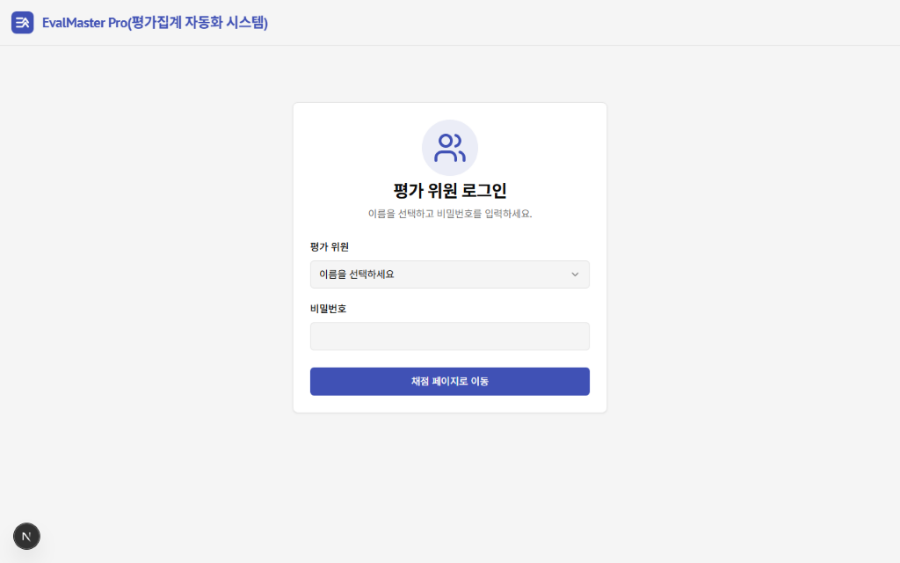
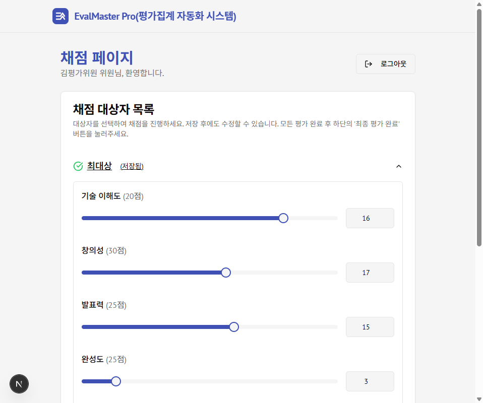
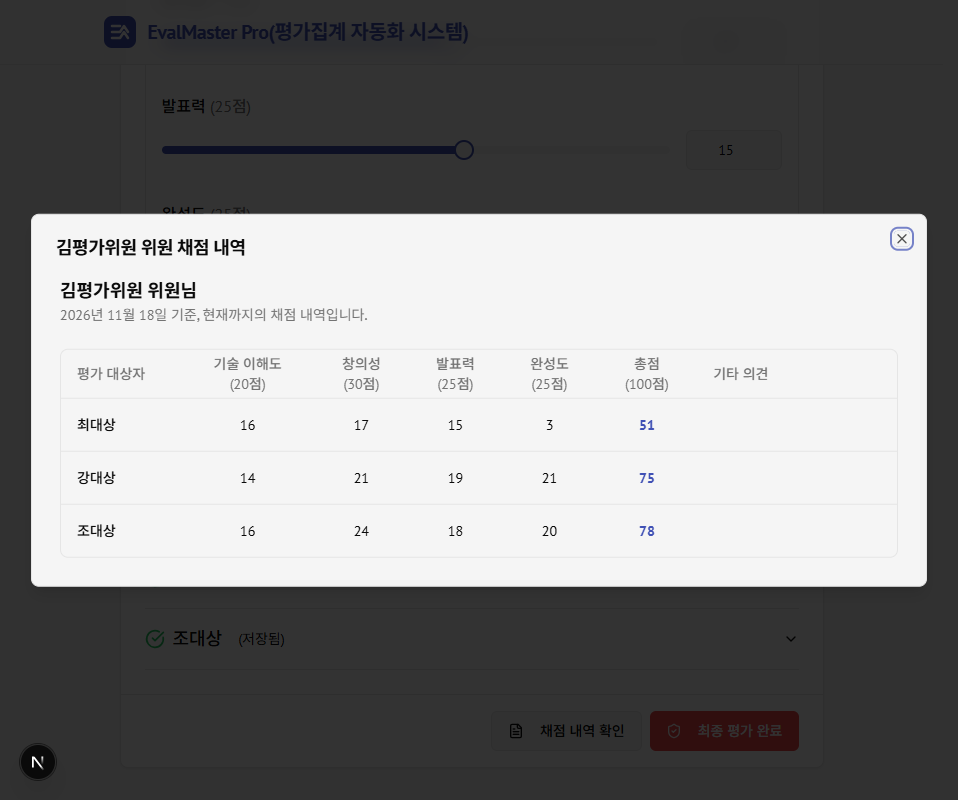
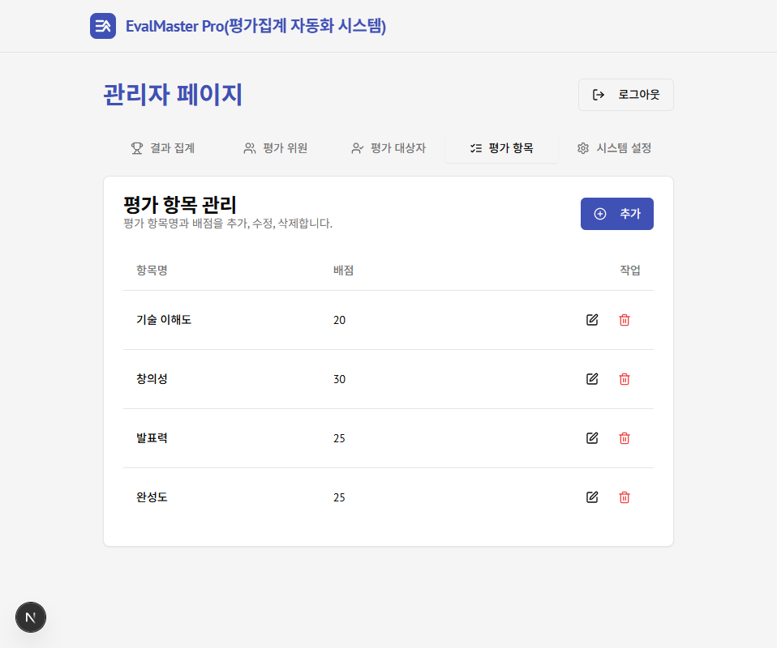
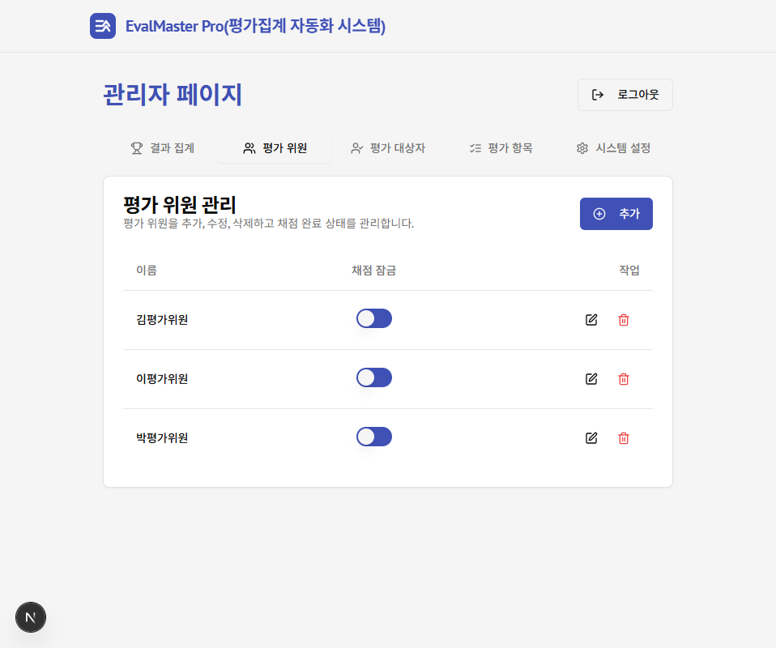
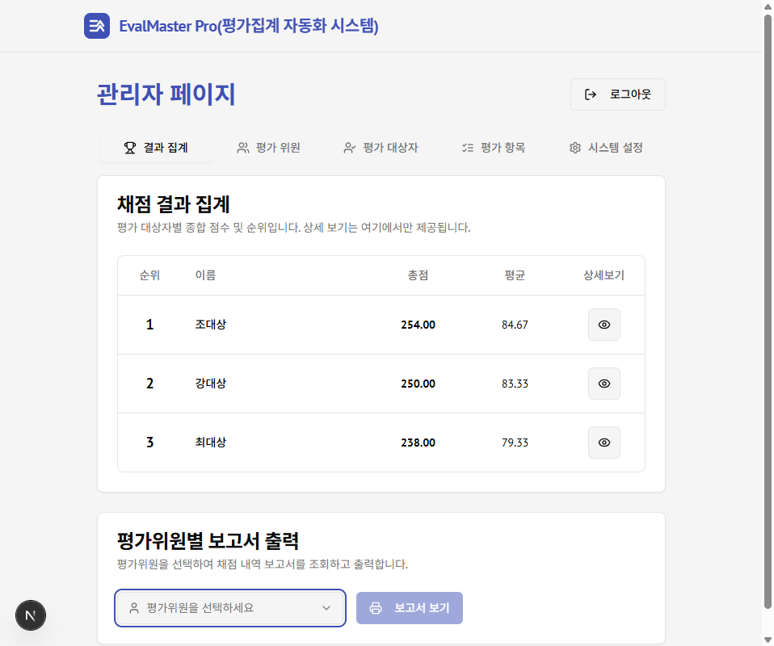
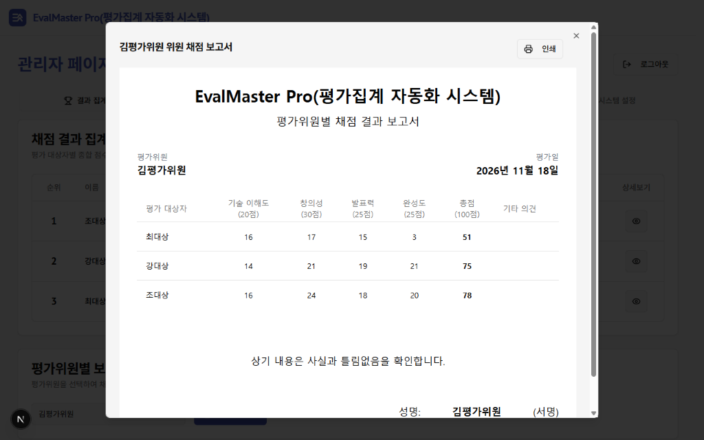
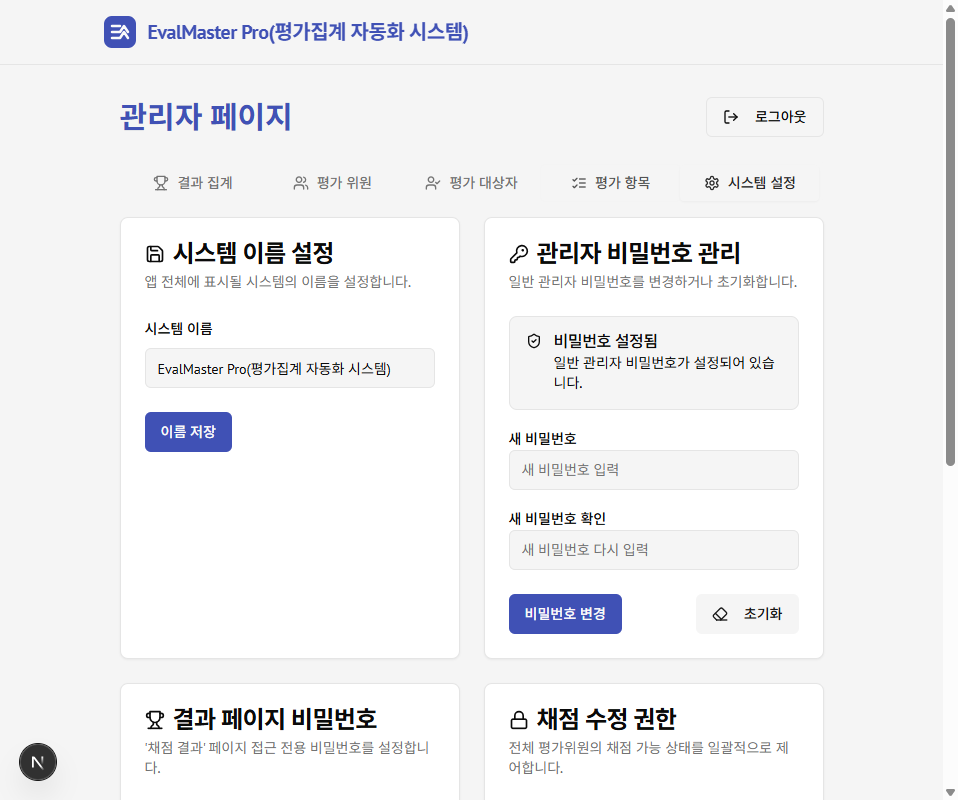
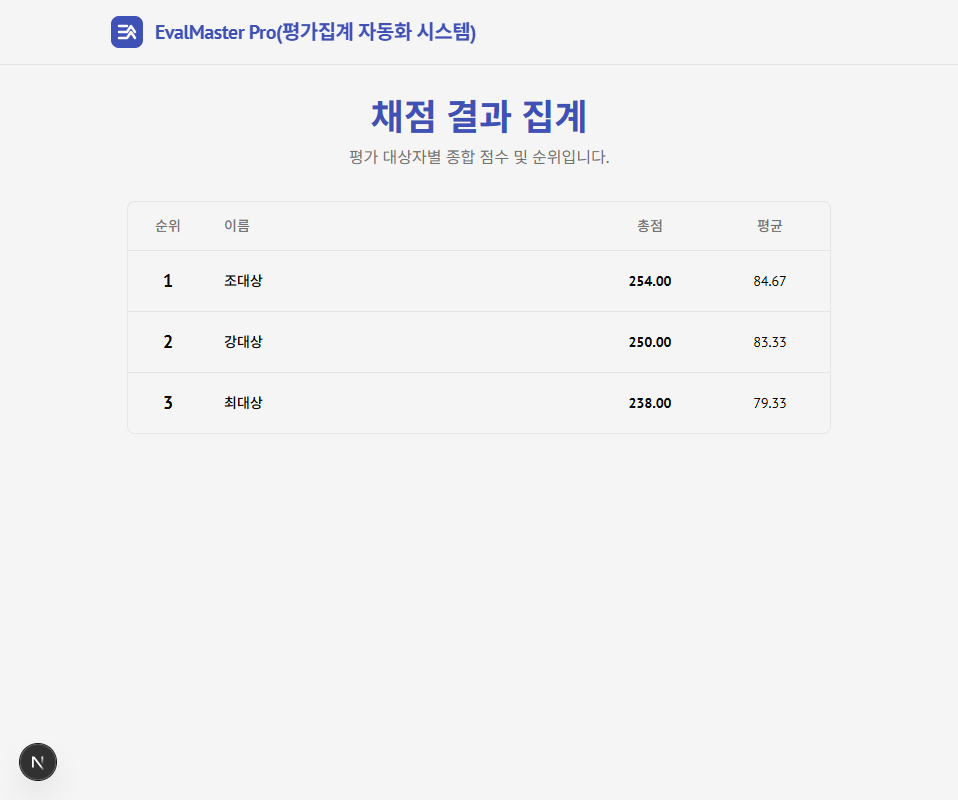

# 🏆 EvalMaster Pro (이발마스터 프로)

> **정확하고 공정한 심사를 위한 실시간 평가·채점 및 결과 집계 웹 애플리케이션**

**EvalMaster Pro**는 공모전, 해커톤, 제안서 심사, 채용 면접, 인사 평가 등에서 여러 명의 평가위원이 실시간으로 대상자를 채점하고, 관리자가 평가 기준·위원·잠금 상태를 제어하며, 종합 순위와 서명이 포함된 공식 심사 보고서를 즉시 산출할 수 있는 웹 솔루션입니다.

- **운영 서버 URL**: https://studio--evalmaster-pro.us-central1.hosted.app/
- 테스트/사용 문의: `accdong@korea.kr`

---

## 📑 목차
- [한눈에 보는 화면 구성](#-한눈에-보는-화면-구성)
- [초기 접속 정보 및 기본 비밀번호](#-초기-접속-정보-및-기본-비밀번호)
- [신규 사용자 이용 가이드 (화면별 안내)](#-신규-사용자-이용-가이드-화면별-안내)
  - [1. 평가위원 가이드 (실시간 채점 및 제출)](#1-평가위원-가이드-실시간-채점-및-제출)
  - [2. 관리자 가이드 (심사 준비 · 결과 집계 · 보고서 출력)](#2-관리자-가이드-심사-준비--결과-집계--보고서-출력)
  - [3. 결과 열람자 가이드 (종합 순위 확인)](#3-결과-열람자-가이드-종합-순위-확인)
- [로컬 개발 및 테스트 환경 설정](#-로컬-개발-및-테스트-환경-설정)
- [심사·배포용 패키징 및 원클릭 실행](#-심사배포용-패키징-및-원클릭-실행)
- [배포 가이드](#-배포-가이드)
- [자주 묻는 질문 (FAQ)](#-자주-묻는-질문-faq)
- [기술 스택 및 프로젝트 구조](#-기술-스택-및-프로젝트-구조)

---

## 🖥️ 한눈에 보는 화면 구성

첫 화면(`/`)에서는 역할에 따라 **평가 위원**, **관리자**, **채점 결과** 세 가지 메뉴로 바로 이동할 수 있습니다.



| 메뉴 | 경로 | 주요 역할 |
| :--- | :--- | :--- |
| **평가 위원** | `/evaluate` | 본인 계정 선택 로그인, 항목별 슬라이더 채점, 기타 의견 작성, 채점 내역 확인, 최종 제출 |
| **관리자** | `/admin` | 결과 집계 및 위원별 상세 조회, 보고서 인쇄, 위원/대상자/항목 관리, 잠금 제어, 비밀번호/초기화 설정 |
| **채점 결과** | `/results` | 결과 열람 비밀번호 입력 후 평가 대상자별 종합 순위·총점·평균 확인 |

---

## 🔑 초기 접속 정보 및 기본 비밀번호

Firestore가 비어 있는 상태에서 앱을 처음 실행하면 아래의 샘플 데이터와 초기 비밀번호가 자동으로 생성됩니다.

| 구분 | 초기 계정 / 명칭 | 초기 비밀번호 | 비고 |
| :--- | :--- | :--- | :--- |
| **슈퍼 마스터 비밀번호** | 마스터 권한 | `0132` | 관리자(`/admin`) 및 결과(`/results`) 비상 복구용 (고정값) |
| **일반 관리자 (`/admin`)** | 시스템 관리자 | `1` | 관리자 `시스템 설정` 탭에서 변경/초기화 가능 |
| **결과 조회 (`/results`)** | 결과 열람 권한 | `1` | 관리자 `시스템 설정` 탭에서 변경/초기화 가능 |
| **기본 평가위원 (`/evaluate`)** | `김평가`, `이평가`, `박평가` | `1` | 관리자 `평가 위원` 탭에서 이름·비밀번호 수정 및 추가 가능 |

> [!TIP]
> 공개된 데모/운영 환경에서는 보안을 위해 비밀번호가 별도로 설정되어 있을 수 있습니다(예: 테스트 계정 `0000`). 비밀번호를 분실한 관리자는 슈퍼 마스터 비밀번호(`0132`)로 로그인해 재설정할 수 있습니다.

---

## 📖 신규 사용자 이용 가이드 (화면별 안내)

### 1. 평가위원 가이드 (실시간 채점 및 제출)

#### Step 1. 평가위원 로그인 (`/evaluate`)
1. 메인 화면에서 **평가 위원** 카드를 클릭합니다.
2. 드롭다운에서 본인 이름을 선택하고 부여받은 비밀번호를 입력한 뒤 **채점 페이지로 이동**을 누릅니다.



#### Step 2. 대상자별 점수 및 기타 의견 입력
1. **채점 대상자 목록**에서 평가할 대상자 이름을 클릭해 채점 패널을 펼칩니다.
   - 노란색 느낌표(`!`): 미채점 대상자
   - 초록색 체크(`✓`): 저장됨(수정 가능 상태)
   - 빨간색 자물쇠(`🔒`): 수정 불가(잠금 상태)
2. 각 평가 항목의 **슬라이더**를 좌우로 움직여 점수를 선택합니다(우측 점수 칸은 실수 입력을 막기 위한 읽기 전용 표시창입니다).
3. 필요한 경우 **기타 의견 (최대 300자)** 란에 정성 평가를 작성합니다.
4. 우측 하단의 **저장하기** 버튼을 누르고 확인 팝업에서 저장을 확정합니다.



#### Step 3. 전체 채점 내역 확인 및 최종 평가 완료
1. 모든 대상자를 채점·저장한 뒤, 카드 하단 왼쪽의 **채점 내역 확인** 버튼을 눌러 본인이 입력한 전체 대상자별 점수표와 총점을 한 번에 점검합니다.
2. 이상이 없다면 **최종 평가 완료** 버튼을 눌러 최종 제출합니다.



> [!IMPORTANT]
> **최종 평가 완료**를 누르면 해당 평가위원의 채점 상태가 잠기며(`수정 불가`), 이후 점수 수정이 필요할 경우 관리자에게 잠금 해제를 요청해야 합니다.

---

### 2. 관리자 가이드 (심사 준비 · 결과 집계 · 보고서 출력)

메인 화면에서 **관리자** 카드를 클릭해 `/admin`으로 이동한 뒤, 관리자 비밀번호(또는 비상용 슈퍼 비밀번호 `0132`)로 로그인합니다.

#### Step 1. 심사 기준 · 대상자 · 평가위원 등록 (`평가 항목` / `평가 대상자` / `평가 위원` 탭)
심사 시작 전 상단 탭을 순서대로 이동하며 기본 정보를 설정합니다.

- **평가 항목** 탭: 심사 항목명과 항목별 최대 배점을 추가·수정·삭제합니다.



- **평가 대상자** 탭: 심사에 참여할 후보자 또는 팀 이름을 등록·수정·삭제합니다.
- **평가 위원** 탭: 평가위원 이름과 로그인 비밀번호를 설정하며, 심사 중에는 **채점 잠금** 토글 스위치로 위원별 제출/수정 가능 상태를 개별 제어할 수 있습니다.



> [!NOTE]
> 평가위원·대상자·항목을 삭제하면 해당 항목과 연관된 기존 점수 및 의견 데이터도 함께 정리되어 집계 오류를 방지합니다.

#### Step 2. 실시간 채점 결과 집계 및 상세 조회 (`결과 집계` 탭)
1. **채점 결과 집계** 표에서 평균 점수 기준 실시간 순위, 총점, 평균을 확인합니다.
2. 각 대상자 행 우측의 **상세보기(눈 아이콘)** 버튼을 클릭하면 어떤 평가위원이 몇 점을 부여했는지(미채점 여부 포함) 팝업으로 확인할 수 있습니다.



#### Step 3. 평가위원별 공식 보고서 조회 및 A4 인쇄
1. `결과 집계` 탭 하단의 **평가위원별 보고서 출력** 영역에서 평가위원을 선택하고 **보고서 보기**를 클릭합니다.
2. 대상자별 항목 점수, 총점, 기타 의견과 하단 **성명 및 서명란**이 포함된 보고서 미리보기가 열립니다.
3. 우측 상단 **인쇄** 버튼을 누르면 A4 세로 규격에 맞춘 인쇄 창이 열리며, 종이 출력 또는 PDF 저장을 진행할 수 있습니다.



#### Step 4. 시스템 이름 · 비밀번호 · 일괄 잠금 및 초기화 (`시스템 설정` 탭)
`시스템 설정` 탭에서 다음 운영 설정을 관리합니다.
- **시스템 이름 설정**: 헤더와 홈 화면, 보고서에 표시되는 대회/시스템 명칭 변경
- **관리자 비밀번호 관리 / 결과 페이지 비밀번호**: 각 페이지의 접근 비밀번호 변경 또는 초기화
- **채점 수정 권한**: 전체 평가위원의 채점 잠금 상태를 한 번에 잠그거나(`수정 불가`) 해제(`수정 가능`)
- **시스템 초기화**: 다음 회차 심사를 위해 모든 위원·대상자·항목·점수·의견 데이터를 초기 샘플 상태로 재설정



---

### 3. 결과 열람자 가이드 (종합 순위 확인)

1. 메인 화면에서 **채점 결과** 카드를 클릭해 `/results`로 이동합니다.
2. 관리자에게 안내받은 **결과 열람 비밀번호**를 입력하고 **결과 보기**를 클릭합니다.
3. 평가 대상자별 최종 **순위, 이름, 총점, 평균**이 표시된 종합 순위표를 확인합니다. *(평가위원별 개별 점수는 보안상 관리자 페이지에서만 열람할 수 있습니다.)*



---

## 💻 로컬 개발 및 테스트 환경 설정

### 1. 필수 사전 요구사항
- **Node.js**: `v20.0.0` 이상 권장
- **npm**: `v10.0.0` 이상

### 2. 환경 변수 설정 (`.env.local`)
루트의 `.env.local.example`을 복사해 `.env.local` 파일을 만들고 Firebase 웹 앱 구성 값을 입력합니다.

```env
NEXT_PUBLIC_FIREBASE_API_KEY="AIzaSy..."
NEXT_PUBLIC_FIREBASE_AUTH_DOMAIN="your-project.firebaseapp.com"
NEXT_PUBLIC_FIREBASE_PROJECT_ID="your-project"
NEXT_PUBLIC_FIREBASE_STORAGE_BUCKET="your-project.firebasestorage.app"
NEXT_PUBLIC_FIREBASE_MESSAGING_SENDER_ID="123456789012"
NEXT_PUBLIC_FIREBASE_APP_ID="1:123456789012:web:abcdef..."
```

### 3. 설치 · 검증 · 실행 명령어
```bash
# 의존성 패키지 설치
npm install

# TypeScript 타입 검사
npm run typecheck

# 도메인 계산 로직 단위 테스트
npm test

# 프로덕션 빌드 확인
npm run build

# 로컬 개발 서버 실행 (기본 포트: 9002)
npm run dev
```

브라우저에서 `http://localhost:9002`로 접속합니다. 만약 Firestore 권한 오류 팝업(`중요: Firebase 권한 설정 필요`)이 표시되면 팝업 안내에 따라 Firebase 콘솔에서 Firestore 보안 규칙을 설정한 뒤 새로고침하세요.

*(참고: `.env.local`이 없거나 `NEXT_PUBLIC_DEMO_MODE=true`로 실행하면 자동으로 **로컬 데모 모드**로 동작해 브라우저 `localStorage` 기반으로 즉시 테스트할 수 있습니다.)*

---

## 📦 심사·배포용 패키징 및 원클릭 실행

공모전 심사위원이나 외부 평가자가 별도 `npm install`이나 Firebase 설정 없이도 즉시 테스트할 수 있도록 **독립 실행형(Standalone) 배포 패키지**와 **Docker 실행 환경**을 제공합니다.

### 방법 1: 원클릭 배포 패키지 생성 및 실행 (추천)
```bash
# 1) 오프라인/독립 심사 테스트용 패키지 생성 (로컬 데모 모드)
npm run package

# (선택) Firebase 실시간 DB가 연결된 배포 패키지 생성
npm run package:firebase
```
실행이 완료되면 `dist/` 폴더에 실행 디렉터리와 압축 파일(`dist/evalmaster-pro-v0.1.0-demo.zip`)이 생성됩니다.

#### 심사위원 실행 방법 (패키지 압축 해제 후)
- **Windows**: 폴더 내 **`start.bat`** 더블 클릭 (자동으로 서버 기동 및 `http://localhost:9002` 브라우저 열기)
- **macOS / Linux**:
  ```bash
  chmod +x start.sh
  ./start.sh
  ```
- **포함 파일**:
  - `server.js` + 최소 `node_modules` + `.next/static` (별도 패키지 설치 불필요, Node.js v20+만 있으면 즉시 실행)
  - `start.bat` / `start.sh` (원클릭 실행 스크립트)
  - `JUDGE_GUIDE.md` (심사위원용 접속 비밀번호 및 3분 테스트 시나리오 안내서)

### 방법 2: Docker 원커맨드 실행
Docker가 설치된 환경에서는 별도 Node.js 설치 없이 컨테이너로 바로 실행할 수 있습니다.
```bash
# 기본 로컬 데모 모드로 빌드 및 실행 (http://localhost:9002)
docker compose up -d --build
```
Firebase 프로젝트를 연결해 컨테이너로 배포하려면 빌드 시 환경 변수를 함께 전달합니다:
```bash
NEXT_PUBLIC_DEMO_MODE=false \
NEXT_PUBLIC_FIREBASE_API_KEY="AIzaSy..." \
NEXT_PUBLIC_FIREBASE_AUTH_DOMAIN="your-project.firebaseapp.com" \
NEXT_PUBLIC_FIREBASE_PROJECT_ID="your-project" \
NEXT_PUBLIC_FIREBASE_STORAGE_BUCKET="your-project.firebasestorage.app" \
NEXT_PUBLIC_FIREBASE_MESSAGING_SENDER_ID="123456789012" \
NEXT_PUBLIC_FIREBASE_APP_ID="1:123456789012:web:abcdef..." \
docker compose up -d --build
```

---

## 🚀 배포 가이드

### 방법 A: Firebase App Hosting (추천)
저장소에 포함된 [`apphosting.yaml`](apphosting.yaml) 설정을 사용해 Firebase App Hosting으로 배포할 수 있습니다.
1. GitHub 저장소에 코드를 푸시합니다.
2. [Firebase 콘솔](https://console.firebase.google.com/) > **빌드** > **App Hosting**에서 저장소와 브랜치를 연결합니다.
3. 환경 변수(`NEXT_PUBLIC_FIREBASE_*`)를 설정한 뒤 자동 빌드 및 배포를 진행합니다.

### 방법 B: Vercel
1. [Vercel](https://vercel.com/)에서 프로젝트를 임포트합니다.
2. **Environment Variables**에 `.env.local`의 `NEXT_PUBLIC_FIREBASE_*` 변수 6개를 등록합니다.
3. **Deploy**를 실행해 배포합니다.

---

## ❓ 자주 묻는 질문 (FAQ)

**Q. 관리자 비밀번호나 결과 페이지 비밀번호를 잊어버렸습니다.**
> 비상 복구용 **슈퍼 마스터 비밀번호 `0132`**를 입력하면 언제든 관리자(`/admin`) 또는 결과(`/results`) 페이지에 접속할 수 있으며, 관리자 페이지의 `시스템 설정` 탭에서 일반 비밀번호를 재설정할 수 있습니다.

**Q. 평가위원이 `최종 평가 완료`를 누른 뒤 점수를 수정하고 싶어합니다.**
> 관리자 페이지(`/admin`) > `평가 위원` 탭에서 해당 평가위원의 **채점 잠금** 스위치를 끄면(해제) 다시 채점과 저장이 가능해집니다.

**Q. 평가위원에게 0점을 주고 저장할 수 있나요?**
> 네, 슬라이더 기본 위치(`0`) 상태에서도 **저장하기**를 누르면 `0`점으로 정상 저장되며, 관리자 결과 상세보기에도 `미채점`이 아닌 `0`점으로 정확히 구분되어 표시됩니다.

**Q. 새로운 대회를 위해 모든 데이터를 초기화하고 싶습니다.**
> 관리자 페이지(`/admin`) > `시스템 설정` 탭 하단의 **시스템 전체 데이터 초기화** 버튼을 누르면 모든 데이터가 삭제되고 초기 샘플 상태로 재설정됩니다.

---

## 🛠️ 기술 스택 및 프로젝트 구조

### 기술 스택
- **Framework**: Next.js 15.3.8 (App Router), React 18
- **Language**: TypeScript 5
- **Database**: Google Cloud Firestore (Real-time `onSnapshot`)
- **Styling & UI**: Tailwind CSS, Radix UI (shadcn/ui), Lucide React
- **AI Integration**: Google Genkit (`@genkit-ai/googleai`)

### 주요 디렉터리 구조
```text
src/
├── app/                 # App Router 페이지 (/, /evaluate, /admin, /results)
├── components/
│   ├── admin/           # 관리자 대시보드, CRUD 관리, 인쇄 보고서, 시스템 설정
│   ├── common/          # 공용 헤더, 로고, 로그인 카드, 확인 다이얼로그, 로딩 스켈레톤
│   ├── evaluate/        # 평가위원 로그인, 실시간 채점 대시보드, 채점 내역 요약
│   ├── results/         # 결과 열람 로그인 및 순위 집계 테이블
│   └── ui/              # shadcn/ui 기본 컴포넌트
├── lib/
│   ├── firebase.ts      # Firebase / Firestore 초기화
│   ├── store.tsx        # 전역 Firestore 상태 관리 컨텍스트
│   ├── evaluation.ts    # 순위/평균 집계 및 보고서 데이터 계산 순수 함수
│   ├── printReport.ts   # A4 보고서 인쇄 창 생성 유틸리티
│   └── __tests__/       # 도메인 로직 단위 테스트
└── types/
    └── evaluation.ts    # 평가 도메인 타입 및 상수 정의
```
